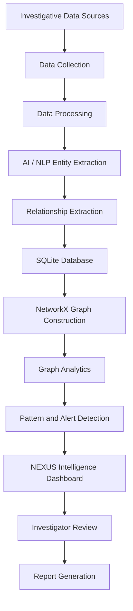

# NEXUS — AI-Powered Criminal Network Analysis & Intelligence System

  <strong>Transforming fragmented investigative data into connected, explainable intelligence.</strong>

  AI • Natural Language Processing • Graph Analytics • Intelligence Visualization

---

## 📌 Overview

**NEXUS** is an AI-powered criminal network analysis and intelligence platform designed to help authorized investigators analyze complex investigative data, identify relationships between entities, and uncover potentially significant patterns across multiple sources of information.

Modern investigations may involve thousands of records containing information about people, organizations, locations, vehicles, phone numbers, financial transactions, and communication records. Although this information may already exist, identifying meaningful connections between these records can be difficult, time-consuming, and resource-intensive.

NEXUS addresses this challenge by transforming fragmented investigative information into a connected, explainable intelligence network.

By combining Artificial Intelligence (AI), Natural Language Processing (NLP), graph-based analysis, and interactive visualization, NEXUS enables investigators to explore relationships, examine network structures, identify potentially important entities, and generate intelligence insights for further investigation.

The platform is designed as an **investigator-support system**, where AI-generated findings serve as investigative leads that require human review and verification.

> NEXUS connects investigative data using AI and graph analysis to uncover relationships, patterns, and potential threats for investigator review.

---

## 🎯 Problem Statement

Investigative agencies often work with large volumes of heterogeneous data collected from different sources, including:

- Case documents and investigation reports
- Public records and intelligence databases
- Communication records
- Financial transaction information
- Vehicle and location records
- Organizational information
- External and publicly available intelligence sources

Traditional investigation workflows frequently require investigators to manually review records and identify relationships between them.

This creates several challenges:

- **Data fragmentation:** Information is distributed across multiple documents and databases.
- **Hidden relationships:** Connections between entities may not be immediately visible.
- **Time-consuming analysis:** Manual investigation becomes difficult as data volume increases.
- **Limited network visibility:** Understanding the structure of complex networks is challenging.
- **Cross-case complexity:** Relationships between separate cases may remain undiscovered.
- **Difficult prioritization:** Investigators may struggle to identify which entities or connections deserve further attention.

NEXUS aims to address these challenges through automated information extraction, graph construction, network analysis, and interactive intelligence visualization.

---

## 💡 Proposed Solution

NEXUS provides a unified intelligence environment that converts investigative information into a structured network of entities and relationships.

The platform follows a data-driven workflow:

1. Collect investigative information from available sources.
2. Process and normalize the collected data.
3. Extract entities and relationships using AI and NLP.
4. Store structured investigative information.
5. Construct a graph network using nodes and edges.
6. Apply graph analytics to identify important entities and network structures.
7. Present potential patterns and connections through an interactive dashboard.
8. Allow investigators to review and verify the generated findings.

The result is a connected intelligence picture that helps investigators understand not only individual records, but also how different entities may be related.

---

## 🚀 Key Features

### 1. AI-Powered Entity Extraction

NEXUS uses AI-based language models and NLP techniques to identify relevant entities from unstructured investigative text.

Supported entity categories include:

- Persons
- Organizations
- Locations
- Vehicles
- Phone numbers
- Bank accounts
- Weapons
- Events

Extracted information can be converted into structured records for further analysis.

### 2. Relationship Extraction

NEXUS identifies potential relationships between extracted entities.

Examples include:

| Relationship | Description |
|---|---|
| `ASSOCIATE_OF` | Potential association between entities |
| `COMMUNICATED_WITH` | Communication relationship |
| `OWNS` | Ownership relationship |
| `LOCATED_AT` | Entity associated with a location |
| `TRANSACTED_WITH` | Financial transaction relationship |
| `MEMBER_OF` | Membership in an organization |
| `INVOLVED_IN` | Entity associated with an event or case |

These relationships form the foundation of the NEXUS intelligence graph.

### 3. Graph-Based Intelligence Analysis

NEXUS represents investigative data as a graph network.

- **Nodes:** Represent entities such as persons, organizations, vehicles, locations, and accounts.
- **Edges:** Represent relationships or connections between entities.

Graph-based analysis helps investigators explore direct and indirect relationships, understand network structures, and examine possible connections across records.

### 4. Network Analytics

NEXUS uses NetworkX to perform graph analysis and identify potentially significant entities and relationships.

The analytical techniques include:

- Degree Centrality
- Betweenness Centrality
- PageRank
- Eigenvector Centrality
- Community Detection
- Shortest Path Analysis
- Link Analysis

These techniques can help identify highly connected entities, possible bridges between groups, influential network positions, and connections between otherwise separate parts of a graph.

### 5. Pattern and Alert Detection

NEXUS can surface potentially important patterns and analytical observations from investigative networks.

Examples include:

- Highly connected entities
- Unusual network structures
- Possible links between separate groups
- Important intermediary entities
- Potentially significant relationships
- Connections requiring additional investigation

Generated alerts are intended to support investigative prioritization and should not be interpreted as proof of criminal activity.

### 6. Interactive Intelligence Dashboard

The NEXUS dashboard provides a centralized interface for exploring investigative information.

The dashboard includes modules such as:

- Command Center
- Network Graph Explorer
- Entity Profiles
- Case Workspaces
- Alerts & Patterns
- Cross-Case Search
- AI Copilot
- Report Generator
- Live Intelligence Stream

The interface is designed to help investigators navigate complex data and understand relationships visually.

### 7. AI Intelligence Copilot

The AI Copilot supports natural-language interaction with investigative information.

It is intended to help users:

- Ask questions about available case information
- Explore relationships within a network
- Understand graph-analysis findings
- Identify entities relevant to a query
- Obtain summaries of investigative information

The Copilot is designed to assist analysis rather than independently determine guilt or make law-enforcement decisions.

### 8. Multi-Provider AI Integration

NEXUS supports integration with multiple AI model providers, including:

- Groq / LLaMA
- Google Gemini
- OpenAI / GPT
- Ollama for local model execution

A heuristic NLP fallback can support selected extraction tasks when an AI provider is unavailable or when deterministic processing is preferred.

Actual model availability and functionality depend on configuration.

### 9. Public Intelligence Integration

NEXUS can integrate publicly available intelligence sources to enrich investigative analysis.

The project includes integration with the FBI Wanted API, which provides access to publicly available FBI Wanted information.

Public-source data should remain distinguishable from synthetic or demonstration data.

### 10. Intelligence Report Generation

NEXUS is designed to support the generation of structured investigative reports containing information such as:

- Case summaries
- Identified entities
- Extracted relationships
- Graph-analysis findings
- Potential patterns and alerts
- Relevant timelines
- Evidence or reference identifiers
- Analyst observations

Reports can help organize analytical findings for further review.

---

## 🏗️ System Architecture

NEXUS follows a modular architecture that connects data ingestion, processing, AI-based extraction, storage, graph analysis, and visualization.

### Architecture Components

| Layer | Technology / Component | Purpose |
|---|---|---|
| Frontend | HTML5, CSS, JavaScript | User interface |
| UI Framework | Tailwind CSS | Responsive styling |
| Backend | Python, FastAPI | Backend services and API layer |
| Database | SQLite | Structured data storage |
| Graph Processing | NetworkX | Graph creation and analytics |
| Data Processing | JSON, Regex | Data parsing and pattern extraction |
| HTTP Integration | HTTPX | External API communication |
| AI / NLP | Groq, Gemini, OpenAI, Ollama | Language understanding and extraction |
| Visualization | Interactive network dashboard | Intelligence exploration |

### High-Level Architecture

---

## 🔄 Project Workflow

### Step 1 — Data Collection

NEXUS collects information from available investigative data sources.

Sources may include case documents, structured records, public intelligence APIs, and demonstration datasets.

### Step 2 — Data Processing

Collected information is processed using Python, JSON, and Regex.

This stage prepares information for extraction and analysis. Regex-based processing can provide deterministic pattern matching for selected data types.

### Step 3 — AI-Based Information Extraction

Unstructured text is analyzed using integrated AI models to identify entities and potential relationships.

The extracted information is converted into structured data.

### Step 4 — Data Storage

Structured investigative information is stored in SQLite.

The database supports the storage of case information, entities, relationships, intelligence records, and alerts.

### Step 5 — Graph Construction

NetworkX converts the structured entities and relationships into a graph.

Each entity becomes a node, while each relationship becomes an edge.

### Step 6 — Graph Analytics

Graph algorithms analyze the network to identify important entities, paths, communities, and structural relationships.

### Step 7 — Intelligence Visualization

The dashboard presents the graph and analytical findings in an interactive interface.

Investigators can explore entities, examine connections, and review potential patterns.

### Step 8 — Human Review

Investigators evaluate the generated insights, verify supporting information, and determine whether further investigation is required.

---

## 🧠 AI and Machine Learning Approach

NEXUS integrates pre-trained deep-learning-based Large Language Models (LLMs) for selected natural-language understanding and information extraction tasks.

The platform does not claim to train a custom deep-learning model from scratch.

The AI layer is intended to support:

- Entity extraction
- Relationship extraction
- Natural-language queries
- Investigative text summarization
- Analytical assistance

Graph analytics are performed using NetworkX algorithms, while deterministic processing techniques such as Regex support selected data-processing tasks.

**Important:** AI-generated extraction results and analytical findings may contain errors. Their accuracy must be evaluated using representative, labeled datasets before operational use.

---

## 🛠️ Technology Stack

### Frontend
- HTML5
- CSS
- JavaScript
- Tailwind CSS
- Material Symbols
- Google Fonts

### Backend
- Python
- FastAPI

### Database
- SQLite

### Graph Analysis
- NetworkX

### Data Processing
- JSON
- Regex
- HTTPX

### AI / NLP
- Groq
- LLaMA
- Google Gemini
- OpenAI GPT models
- Ollama

### External Data Source
- FBI Wanted API

---

## 📂 Project Modules

The NEXUS platform is organized around the following functional modules:

| Module | Description |
|---|---|
| Command Center | Centralized intelligence overview |
| Network Graph Explorer | Interactive graph visualization |
| Entity Profiles | Detailed entity information |
| Case Workspaces | Case-specific investigative environment |
| Alerts & Patterns | Review of potentially significant analytical findings |
| Cross-Case Search | Exploration of relationships across cases |
| AI Copilot | Natural-language investigative assistance |
| Report Generator | Organization of analytical findings into reports |
| Live Intelligence Stream | Presentation of incoming intelligence events |

---

## 🔐 Responsible Use and Limitations

NEXUS is designed as an investigative decision-support platform.

Its analytical results should be used responsibly and reviewed by qualified personnel.

The following principles are important:

- AI-generated findings are not proof of criminal activity.
- Graph relationships do not automatically establish guilt or intent.
- Data accuracy depends on the quality and reliability of source information.
- Potential patterns must be verified using supporting evidence.
- Public data and synthetic demonstration data should be clearly identified.
- Sensitive investigative information should be handled using appropriate security and access-control measures.
- Human investigators remain responsible for interpreting findings and making decisions.

NEXUS should not be used to make autonomous law-enforcement decisions or to label individuals as criminals solely based on AI-generated scores or graph connections.

---

## 🔮 Future Scope

Potential future enhancements include:

- Advanced entity resolution and duplicate detection
- Improved cross-case intelligence correlation
- Real-time intelligence ingestion pipelines
- Advanced graph visualization and filtering
- Explainable AI for analytical findings
- More comprehensive anomaly detection
- Enhanced confidence scoring and calibration
- Graph database integration for larger datasets
- Role-based access control
- Audit logging and investigation history
- Secure deployment for authorized investigative environments
- Evaluation using representative, appropriately governed datasets

These enhancements represent potential future development and should not be interpreted as currently implemented functionality.

---

## 📚 Research & References

The following documentation and data sources provide technical foundations for NEXUS.

1. **NetworkX Documentation**  
   https://networkx.org/documentation/

2. **FastAPI Documentation**  
   https://fastapi.tiangolo.com/

3. **Google Gemini API**  
   https://ai.google.dev/api

4. **Groq API Documentation**  
   https://console.groq.com/docs

5. **FBI Wanted API**  
   https://www.fbi.gov/wanted/api

---

## 🏆 Project Information

**Project Name:** NEXUS  
**Project Category:** Artificial Intelligence / Data Analytics / Intelligence Analysis  
**Project Type:** AI-Powered Criminal Network Analysis and Intelligence System  
**Hackathon:** Smart India Hackathon (SIH) 2026  
**Team:** HACK NOVA

---

## 👥 Team

Developed by **Team HACK NOVA** as an innovation project focused on applying AI, NLP, and graph analytics to investigative intelligence analysis.

---

## ⭐ Conclusion

NEXUS aims to transform the way investigative information is analyzed by connecting fragmented data into a unified intelligence network.

By combining AI-powered information extraction, graph analytics, and interactive visualization, NEXUS helps investigators explore relationships, identify potentially significant patterns, and organize intelligence for further review.

The platform demonstrates how modern AI and graph technologies can support more connected, explainable, and efficient investigative workflows while keeping human judgment at the center of the decision-making process.

**NEXUS — Connect the Data. Reveal the Network. Support the Investigation.**
